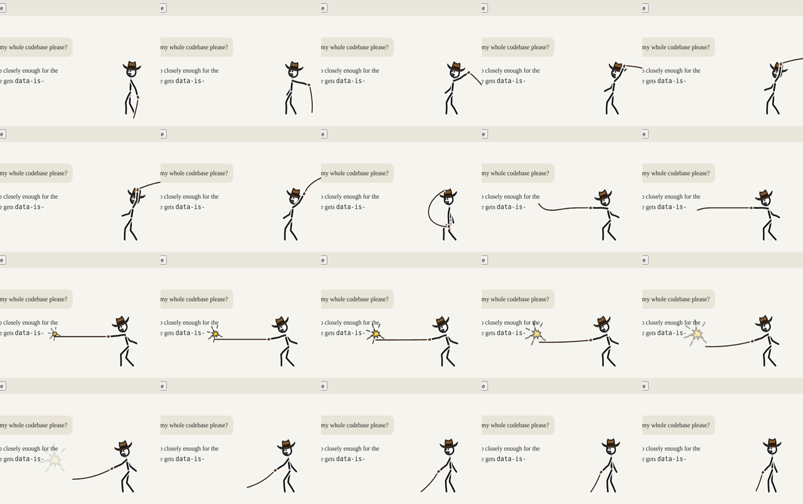
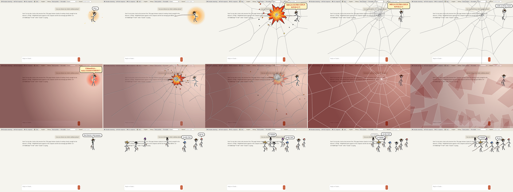
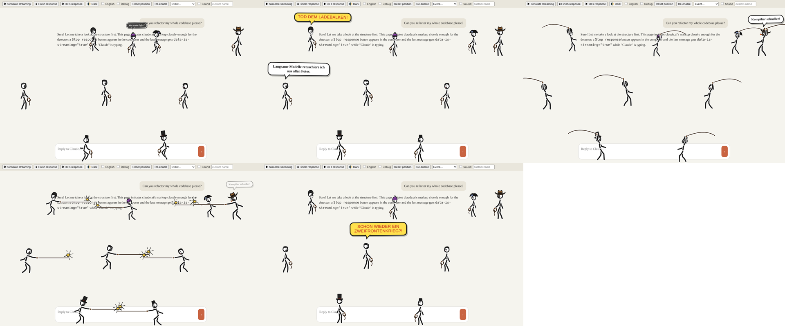
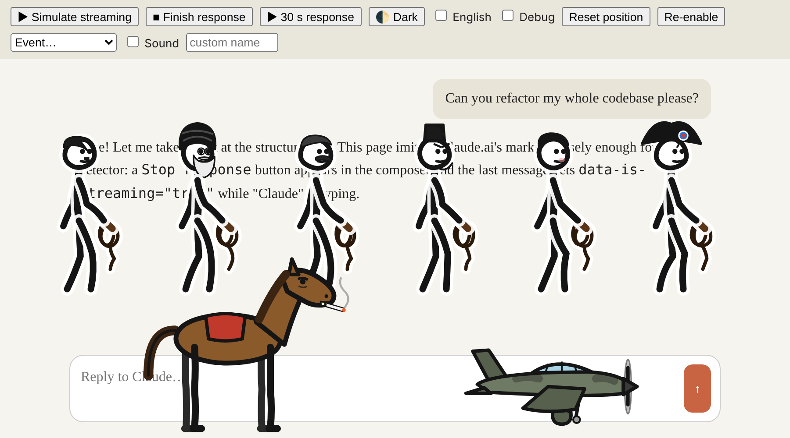
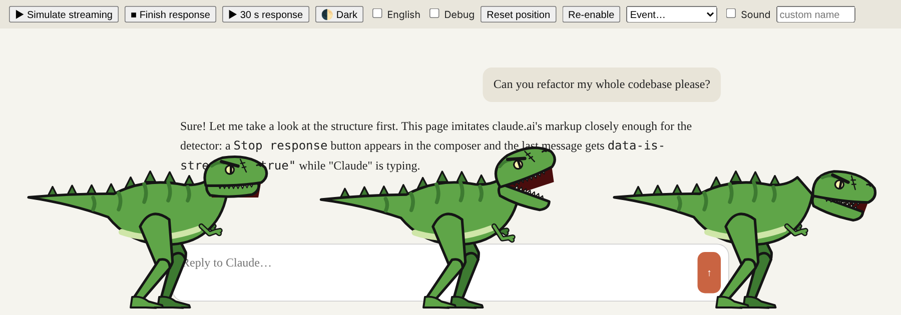
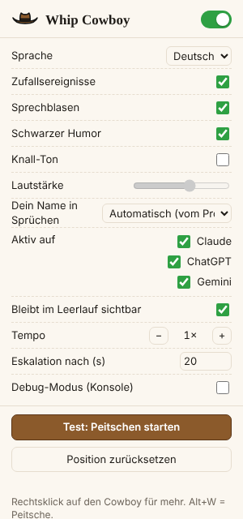

# 🤠 Whip Cowboy

**A stick-figure cowboy who whips your AI while it's thinking.**

A Chrome extension that drops a hand-drawn cowboy onto **Claude**, **ChatGPT** and **Gemini**. As soon as the AI starts writing, he walks in and cracks his whip at the answer, yelling things like *"Kompilier schneller!"*. When it's done he puts on his sunglasses, says *"Perfekt. Bis gleich."* and walks off.

Right-click him for chaos: a MEGA whip crack that shatters your screen, an airstrike, a horseback duel, a T-rex, a stampede and more.



## Install (2 minutes)

It's not on the Chrome Web Store, so you install it by hand:

1. **Download** this repo: green **Code** button → **Download ZIP**, then unzip it.
2. In Chrome, open **`chrome://extensions`** and switch on **Developer mode** (top right).
3. Click **Load unpacked** and choose the unzipped **`whip-cowboy`** folder (the one containing `manifest.json`).
4. Open (or reload) **claude.ai**, **chatgpt.com** or **gemini.google.com** and send a message. 🤠

Pin the 🤠 icon in the toolbar for the settings. Works in any Chromium browser (Chrome, Edge, Brave, Arc).

**Updating:** download the ZIP again, replace the folder, click ↻ on the extension in `chrome://extensions`, and reload the chat tab.

## What it does

- 🤠 **Whips while the AI works.** The longer it takes, the angrier he gets.
- 💥 **Right-click menu** with events: MEGA ULTRA GIGA whip crack, world destroyer, reinforcements, airstrike, duel, Jurassic whip, horse ride, stampede, sunset.
- 🎲 **Random events** fire on their own when the AI is slow.
- 💬 **Speech bubbles** in German (like the original video) or English.
- ☠️ **Dark humor mode** (on by default, one click to turn off): edgy jokes aimed at the AI, a crew of history's worst dictators as reinforcements, a chain-smoking horse, a meteor.
- 👤 **Knows your name** (optional) and says some lines on your behalf. The name stays on your computer.
- 🔊 **Sound effects** (off by default), all generated in code.
- **Alt+W** cracks the whip by hand. **Drag** him anywhere.

| | |
|---|---|
|  |  |
|  |  |



## Privacy

No tracking, no servers, no data sent anywhere. Settings are saved in your browser. The extension only *reads* the chat page to see whether the AI is writing, and never changes it.

## Disclaimer

A fan-made parody, not affiliated with Anthropic, OpenAI or Google. The dark humor is satire aimed at the AI and at history's villains; turn it off in the popup if it's not your thing.

---

# Details

## Using it

- Send a message. The cowboy walks in and whips the response every few seconds. After *Eskalation nach* seconds (default 20) he gets angrier: faster double cracks, more taunts, and random events become more likely.
- When the response finishes he nods, says *"Perfekt. Bis gleich."* and walks off. If the task took more than 60 s and random events are on, he rides into a **sunset** instead.
- **Drag** him anywhere. The position is remembered (*Position zurücksetzen* in the popup resets it).
- **Right-click** him for the menu. **Alt+W** (Option+W on a Mac) cracks the whip by hand.

### Events (right-click menu)

| | Event | What happens |
|---|---|---|
| 💥 | MEGA ULTRA GIGA PEITSCHENSCHLAG | Glowing charge ("Ultra..."), giant crack, explosion, overlay shake, spider-web glass cracks |
| ☠️ | ULTIMATIVER WELTZERSTÖRER | Screen tints red, whip whirls overhead, full-screen shattered glass, shards fall away |
| 📻 | Verstärkung rufen | Walkie-talkie call, then 5–8 stick figures in different hats run in and whip in sync |
| ✈️ | Luftangriff anfordern | Radio call, "ACHTUNG!!!", a fighter jet drops green missiles on the response, the cowboy ducks |
| 🤠 | Duell gegen {AI} | Horses, a rival with a sunburst head, a 3-2-1 countdown, smoke, banter, a random loser falls off |
| 🦖 | Jurassic Peitsche | A T-rex stomps in, the cowboy rides it and whips it, it roars |
| 🎬 | Szenen ▸ | Ausritt (horse ride), Duell, Stampede, Sonnenuntergang (sunset) |

Toggles in the menu: Zufallsereignisse (random events), Sprechblasen (speech bubbles), Schwarzer Humor (dark humor), Knall-Ton (sound), Schneller / Langsamer (±25 % animation speed), Beenden (hide him until you re-enable him in the popup).

### Popup settings

| Setting | Default | Notes |
|---|---|---|
| On/off switch | on | |
| Sprache / Language | Deutsch | German (as in the video) or English: bubbles, menu, popup |
| Zufallsereignisse | on | While working, an event may fire every ~15 s; the chance rises the longer the AI takes |
| Schwarzer Humor | on | Dark jokes in black bubbles. Also turns the reinforcements into history's worst bosses (Hitler, Khamenei, Stalin, Mussolini, Kim, Napoleon), the airstrike into a WWII dive bomber with siren, and gives the horses a cigarette and a fear of the glue factory |
| Sprechblasen | on | |
| Knall-Ton + Lautstärke | off, 60 % | Every sound is synthesized with the Web Audio API |
| Dein Name in Sprüchen | Automatisch | See *Your name* below |
| Aktiv auf | all three | Turn him on or off per site |
| Bleibt im Leerlauf sichtbar | on | Off = he only shows up while the AI is working (like the video) |
| Tempo | 1× | Same as Schneller / Langsamer in the menu |
| Eskalation nach (s) | 20 | |
| Debug-Modus | off | Logs detection, state changes, events and name detection to the DevTools console |
| Test: Peitschen starten | | Pretends the AI is working for 25 s |

#### Look & feel

- Crude, jittery hand-drawn ink (lines "boil" every ~120 ms). The cowboy has a mustache, stubble, a squint and a smoking cigar. When the AI finishes, sunglasses drop onto his face.
- Every crack pops a comic sound word (KNALL! / PENG! / ZACK!), a floating damage number (−37 HP, sometimes CRIT!) and, from 3 hits on, a COMBO counter. When the answer finishes you get an "N HITS!" summary.
- Bubbles: white comic bubbles for normal lines, black noir bubbles for dark humor, yellow Impact-style shouting once he escalates.
- The popup is a WANTED poster. His lifetime **bounty** grows with every lash and escalation (stored locally in `chrome.storage.local`, never synced or sent).

### Your name (talking on your behalf)

With **Automatisch** the cowboy reads your first name from the site you're on and sometimes uses it, for example *"Im Auftrag von Matin: Tempo, Claude!"*, *"Grüße von Matin, Claude!"* or *"Perfekt. Bis gleich, Matin."*

- **Claude:** the site's own `/api/account` (same origin, your existing session), falling back to the user-menu button.
- **ChatGPT:** the site's own `/api/auth/session`, falling back to the profile button.
- **Gemini:** the "Google Account: …" label of the avatar button.

The name stays in memory on that page only. It is never written to storage and never sent anywhere. Choose **Eigener Name** to type a name yourself, or **Aus** to turn it off.

## He keeps whipping after the AI is done?

Two safeguards handle this. First, a Stop button only counts if it's really visible: hidden, faded-out, zero-size or `aria-hidden` buttons are ignored, because sites often keep them in the page after generation. Second, a **stall guard**: if a "working" signal still matches but nothing on the page has changed for 20 s (`stallDoneMs` in `core/config.js`), he treats the response as done and ignores that stuck element from then on. With Debug mode on, the console prints the stuck element's HTML, so you can add a better selector.

## When a site changes its markup (updating selectors)

Each site's selectors live in **`core/sites.js`**, one profile per site:

```js
selectors: {
  stopButton:   [...], // strongest "working" signal: the Stop button during generation
  streaming:    [...], // message-level flags like [data-is-streaming="true"]
  taskProgress: [...], // optional: the task checklist, used as the anchor if present
  response:     [...], // assistant messages (the LAST visible match is the anchor)
  chatColumn:   [...], // last-resort anchor
}
```

1. Turn on **Debug mode** in the popup, open DevTools (Console) on the chat site, and send a message.
2. If you never see `working signal matched: …`, nothing matches any more. Right-click the Stop button → *Inspect*, and add a selector for it (for example `button[aria-label="…"]` or `[data-testid="…"]`) at the **top** of `stopButton`.
3. If he stands in the wrong place, fix `response` the same way.
4. Click ↻ on the extension card and reload the tab.

If no selector matches, a fallback still treats the last response's text growing as "working" (`useTextGrowthFallback` in `core/config.js`). Timings (crack interval, settle time, the sunset threshold, …) are in `core/config.js` too.

**Adding another chatbot:** add a profile to `SITES` in `core/sites.js` (`hosts` regex, `name`, `rival`, `selectors`, `detectName`), then add its URL to `content_scripts.matches` in `manifest.json`.

## Architecture

```
manifest.json
core/                  portable: no chrome.* APIs (reusable for a Claude Desktop mod)
  util.js              Scope (tracks every timer/listener for cleanup), Clock (one rAF loop + tweens), easing
  i18n.js              all text, DE + EN, with {ai} / {user} placeholders
  sites.js             per-site profiles: selectors, rival look, name detection
  config.js            timings + default settings
  art.js               wobbly hand-drawn SVG helpers, hats
  crew.js              caricature costumes for the dark-humor reinforcements
  figure.js            poseable stick figure: walk, whip crack, nod, celebrate, ride, radio
  creatures.js         Horse, TRex, Jet, Missile (Sprite base)
  stage.js             fixed overlay + Shadow DOM, overlay-only shake
  bubbles.js / menu.js speech bubbles / macOS-style context menu
  detector.js          read-only MutationObserver: IDLE → WORKING → DONE
  sfx.js               Web Audio synthesis
  juice.js             crack sound words, damage numbers, combo counter, bubble styles
  fx.js                explosions, particles, glass cracks/shatter, flash, tint, countdown, glow
  events.js            event registry; events/*.js = one module per event (play() + cleanup)
  app.js               state machine, behaviour, drag, menu, Alt+W, random events
chrome/                Chrome glue only: content.js (storage ↔ app, messages), popup.*
dev/playground.html    fake chat page to test everything without the extension or using up messages
```

**Guarantees:** the overlay is `pointer-events: none` except for the cowboy's body and the menu. It never takes focus from the chat input, never modifies the site's DOM (it only reads it), shakes only itself, and respects `prefers-reduced-motion` (no shake, fades instead of walking, fewer particles). Quitting, disabling, or reloading the extension removes every element, timer, and listener.

**Porting to a Claude Desktop mod:** load `core/*` in the same order as the manifest's `js` list, then call `WhipCowboy.createApp(host, settings)`, where `host = { save(partialSettings) }`. The returned object has `update(settings)`, `handleMessage({type})` and `dispose()`. `dev/playground.js` is a complete example host that uses `localStorage`.

## Dev playground

Open `dev/playground.html` straight from disk in Chrome. It has buttons to simulate streaming (including a 30 s response), toggle dark mode, English, sound and debug, set a custom name, and trigger any event from a dropdown.
